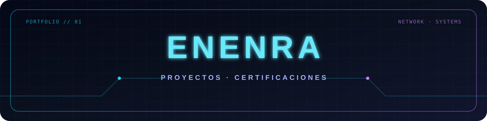

  

<h3 align="center"><samp>PORTAFOLIO TÉCNICO &nbsp;·&nbsp; 03 PROYECTOS &nbsp;·&nbsp; 05 CERTIFICACIONES</samp></h3>

  
  
  

  

<h2 align="center">⚙️ &nbsp; Proyectos</h2>

<table width="100%" border="1" cellspacing="0" cellpadding="14">
  <tr><td>
    <h3>01 &nbsp;·&nbsp; Infraestructura de redes Cisco</h3>
    
  

    
Diseño de topologías corporativas, cálculo de subredes VLSM y configuración de routers y switches Cisco. Implementación de OSPF y RIP para lograr conectividad de extremo a extremo.

  </td></tr>
  <tr><td>
    <h3>02 &nbsp;·&nbsp; Servidores contenerizados</h3>
    
  

    
Despliegue de Apache y MySQL en contenedores Docker sobre Ubuntu Server, con gestión de usuarios, permisos y comunicación interna entre servicios.

  </td></tr>
  <tr><td>
    <h3>03 &nbsp;·&nbsp; App móvil de geolocalización y reciclaje</h3>
    
  

    
Co-diseño y desarrollo de una app para localizar centros de acopio en Santiago. Incluye autenticación de usuarios y sincronización de datos en Firebase.

  </td></tr>
</table>

  

<h2 align="center">🛠️ &nbsp; Technologies</h2>

<table align="center" border="1" cellspacing="0" cellpadding="14">
  <tr>
    <td align="center"></td>
    <td align="center"></td>
    <td align="center"></td>
    <td align="center"></td>
    <td align="center"></td>
  </tr><tr>
    <td align="center"></td>
    <td align="center"></td>
    <td align="center"></td>
    <td align="center"></td>
    <td align="center"></td>
  </tr>
</table>

<h2 align="center">🏅 &nbsp; Certificaciones y formación</h2>

<table width="100%" border="1" cellspacing="0" cellpadding="12">
  <tr>
    <td width="50%" align="center"></td>
    <td width="50%" align="center"></td>
  </tr><tr>
    <td align="center"></td>
    <td align="center"></td>
  </tr><tr>
    <td colspan="2" align="center"></td>
  </tr>
</table>
